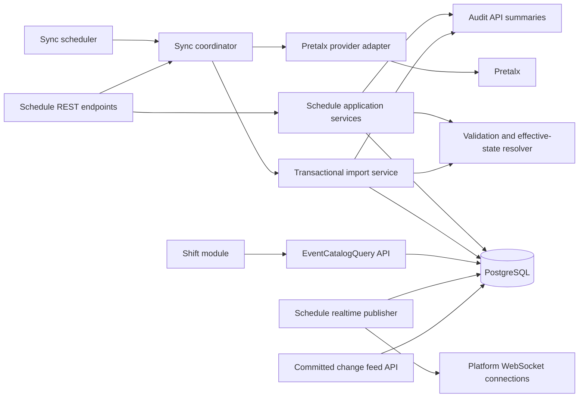
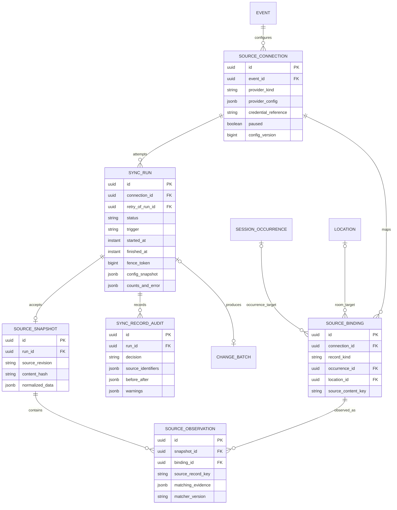
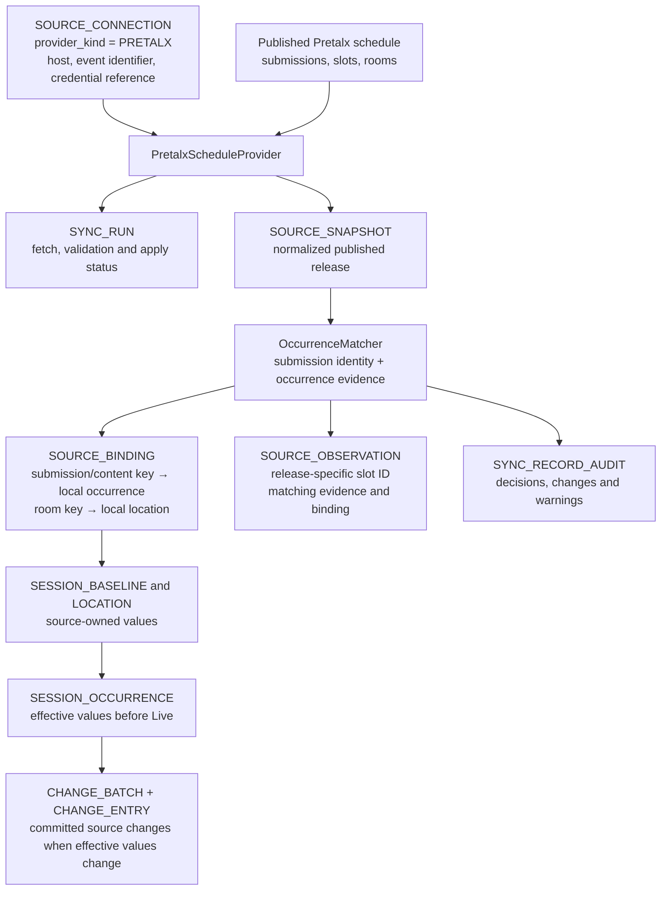
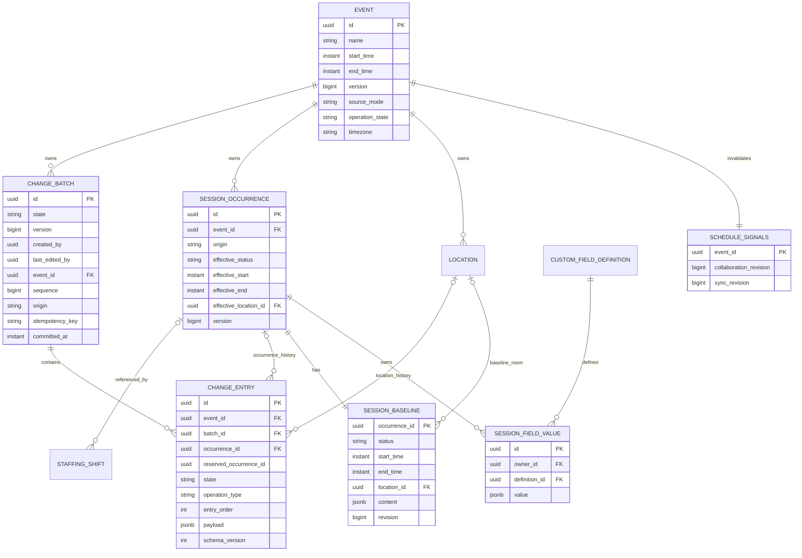

# ScheduleControl phase 1 — backend architecture

This is the implementation plan for the backend phase of [the requirements](schedulecontrol-requirements.md). It is a proposed architecture, not a description of implemented behavior. The calendar and Activity modal follow in phase 2; their backend contracts, collaborative drafts, and update signals belong here.

Existing database contents do not need to survive this overhaul. Design the schema cleanly and use a fresh database for cutover; there is no legacy data import, backfill, or dual-write phase. Source-mode migration between Managed and Synced is also outside phase 1.

## The main choices

- Keep the single Spring Boot application and PostgreSQL database. Expand `eventcatalog` internally; use **Schedule** in the product and new HTTP API. A module/package rename adds little value to this phase.
- Keep one session entity per scheduled occurrence, with a stable local UUID. A Pretalx submission ID identifies content, not an occurrence.
- Store the baseline and a materialized effective schedule. Use stateful `CHANGE_ENTRY` rows for proposed and committed operations. Committed entries are the source of truth for local overrides. Normal schedule reads use the materialized values.
- Freeze each change entry when it commits. Keep the committed journal and a separate sync-run audit. The journal explains schedule changes; the sync audit also explains failures, no-change imports, and matching decisions.
- Persist collaborative drafts. Use revision checks and explicit review before commit, not silent last-write-wins editing.
- Serialize committed schedule writes per event using a short database row lock. Network requests stay outside that lock. Creating the shared draft also uses the event lock.
- Allow sync before Live activation. Enter Live explicitly, freeze the baseline, and disable all sync for the event. Live is a terminal operating state for phase 1.
- Use database-backed revisions and the existing WebSocket invalidation mechanism for UI updates. The committed change feed is durable and independent of WebSocket delivery.

## How this fits the code we have

| Existing code | Plan |
| --- | --- |
| `eventcatalog.event`, `.session`, `.location` | Retain ownership of events, occurrences, and locations; replace the flat session/read-only model with the model below. |
| `eventcatalog.api.EventCatalogQuery` | Preserve the cross-module boundary and extend its DTOs with effective timing, location, status, and revision. Do not expose JPA entities. |
| `SessionService` | Currently enforces unique names and event date bounds. Allow repeated names; turn event date bounds into reviewable warnings. Replace the `readOnly` flag with source ownership and event mode/state checks. |
| `shift` | Owns shifts and assignments, not schedule overrides or source ingestion. Existing adapters must delegate to the new schedule application services. |
| `shift.sync.pretalx` and API-key remnants | Replace with an event-scoped provider adapter and connection model in `eventcatalog.sync`; do not extend legacy token DTOs as the new API. |
| `audit.api.AuditRecorder` | Continue writing concise, safe summaries for the general audit timeline. Full schedule content/history lives in schedule-owned tables. |
| `platform.realtime.api.RealtimeConnections` | Reuse authenticated connections and type-only refresh signals. Add a schedule publisher following the existing database revision polling approach. |
| Module-owned Liquibase changelogs | Define the new schema under `eventcatalog`; coordinate changed foreign keys with `shift`. Test the master changelog, not only Hibernate's local schema updates. |

The current general audit API accepts scalar values up to 1,024 characters and has its own retention policy. It is not suitable as the sole store for abstracts, descriptions, source snapshots, or durable schedule history. Schedule history must remain valid if a general audit summary expires.

## Module and service layout



Keep endpoints thin: authenticate, authorize, validate request shape, call an application service, map the result. Commands own transaction boundaries; pure validators/resolvers have no persistence side effects.

| Package / planned service | Responsibility |
| --- | --- |
| `eventcatalog.schedule.ScheduleStateService` | Configure mode, enter Live operations, review activation and coordinate sync shutdown, update timezone and schedule settings. |
| `eventcatalog.schedule.PlanningService` | Direct baseline CRUD in Managed + Planning, with revisions and journal records. |
| `eventcatalog.session.EffectiveSessionResolver` | Pure function combining baseline, active overrides, and local additions. Shared by preview, commit, import, and rebuild checks. |
| `eventcatalog.session.ScheduleValidator` | Hard errors, room overlap warnings, event-bound warnings, content field validation, and same-event reference checks. |
| `eventcatalog.location.ScheduleLocationService` | Create local rooms, retire rooms, update locally owned details, and persist shared ordering. Imported metadata remains source-owned. |
| `platform.customfields` | Shared field definitions, types, configuration, validation, and domain-owned current-value storage. Schedule commands coordinate writes with change entries. |
| `eventcatalog.change.ChangeBatchService` | Create, edit, list, and discard shared drafts with optimistic concurrency and contributor history. |
| `eventcatalog.change.BatchReviewService` | Calculate a preview from draft entries and current schedule data, returning before/after values, warnings, batch version, and latest committed batch sequence. |
| `eventcatalog.change.ScheduleCommitService` | Validate review and permissions; atomically apply the draft, update projections, append journal/feed records, and mark it committed. |
| `eventcatalog.change.ScheduleHistoryQuery` | Occurrence history, batch detail, baseline history, and cursor-based committed feed. |
| `eventcatalog.api.EventCatalogQueryService` | Internal effective schedule facts used by staffing; separate public/staff HTTP DTO projections. |
| `eventcatalog.sync.SourceConnectionService` | Provider configuration, write-only credentials, pause/resume, sanitized configuration audit. |
| `eventcatalog.sync.SyncCoordinator` | Durable run admission, worker leases, retries, fetching outside the transaction, and failure recovery. |
| `eventcatalog.sync.ScheduleProvider` | Provider-neutral interface returning a validated normalized snapshot and source revision metadata. |
| `eventcatalog.sync.pretalx.PretalxScheduleProvider` | HTTP access, pagination/completeness checks, normalization, and provider capability/version handling. |
| `eventcatalog.sync.OccurrenceMatcher` | Deterministic one-to-one matching using provider evidence and stored mappings; returns decisions and warnings. |
| `eventcatalog.sync.SyncApplyService` | Lock the event, revalidate its pre-Live state and the connection lease, then apply the complete snapshot and write audit and any effective-change batch atomically. |
| `eventcatalog.sync.SyncAuditService` | Run lifecycle records and sanitized failures in independent transactions; query summaries and detailed decisions. |
| `eventcatalog.realtime.ScheduleRealtimePublisher` | Poll durable event revisions, recheck event access, invalidate authorized local clients after committed changes. |
| `eventcatalog.access.ScheduleAccessPolicy` | Event-scoped capabilities for HTTP, application commands, and realtime eligibility. |

These are responsibility boundaries, not a requirement for one class per row immediately. Avoid circular dependencies: sync and drafts call the shared resolver/journal writer, not each other's application services. `shift` consumes `eventcatalog::api`; schedule code does not query shift internals.

## Entity diagram

Names below are logical entity names. Tables remain owned by `eventcatalog` and use its prefix. Foreign-key arrows describe ownership or references; scalar UUID references are fine in JPA rather than loading large object graphs.

### General sync infrastructure

Every schedule provider uses these entities. `SOURCE_BINDING` connects external records to local occurrences or rooms. `SOURCE_OBSERVATION` records the binding evidence in each accepted snapshot. `SYNC_RECORD_AUDIT` records changes, warnings, and decisions made by the run. Consolidating observation data into the record audit remains a possible simplification.

`EVENT`, `SESSION_OCCURRENCE`, `LOCATION`, and `CHANGE_BATCH` are shared entities shown here to make the connections visible. One binding targets either an occurrence or a room. A run produces a committed change batch when it changes the effective schedule.



### Pretalx sync

Pretalx uses the general sync entities above. Its specific parts are the connection configuration, the HTTP adapter, and the interpretation of source identifiers. The following view shows how Pretalx data enters those shared entities. Boxes describing Pretalx records represent external input rather than additional database tables.



Multiple occurrences can share a Pretalx submission key. Each has its own local occurrence identity and binding. Release-specific slot IDs belong to observations, allowing later releases to map back to the same local occurrence.

### Managed schedule and shared editing model

A Managed event uses this model for Planning, Live operations, collaborative drafts, and committed changes. Synced events also use these entities for their effective schedule and local operational changes. `CHANGE_BATCH.state = DRAFT` represents a shared draft, and its entries carry their own proposed operations and lifecycle state.



`STAFFING_SHIFT` stays shift-owned. The location referenced by a shift through its occurrence is the **effective** room; changing that room does not replace the occurrence identity. The diagrams omit some actor columns, foreign keys to event on child records, and some location/configuration fields for readability; the table descriptions below define their responsibilities.

### Current schedule state

| Entity | Important fields and rules |
| --- | --- |
| `Event` | Owns event metadata and schedule settings directly. `sourceMode = MANAGED / SYNCED`; `operationState = PLANNING / AWAITING_IMPORT / LIVE`. IANA timezone and JPA optimistic-lock version. The latest committed batch sequence supplies the schedule revision. Managed starts in Planning. Synced starts Awaiting import and enters Planning after its first successful import. Both require explicit activation to enter Live. |
| `ScheduleSignals` | One row per event holding collaboration/sync invalidation counters. Separate from the event row so draft saves and run-status updates do not contend with schedule serialization in the wrong lock order. |
| `SessionOccurrence` | Stable UUID; event; `origin = LOCAL / IMPORTED`; effective time pair, room, status, version. This row is the materialized read model and identity anchor. |
| `SessionBaseline` | One baseline per occurrence, including local additions. Contains source/planning values, `presence = PRESENT / REMOVED`, and baseline revision. Removed baselines retain their last known values. Presence describes membership in the plan or imported schedule; operational cancellation belongs to the effective session status and committed changes. Local additions are identified by origin plus their creation journal entry rather than a fake Pretalx record. |
| `Location` | Stable UUID, event, origin, name/URL, retired flag, shared sort position, version. Sync never changes the local sort position. Retired locations remain resolvable by history and existing occurrences. |
| `CustomFieldDefinition` | Platform-owned definitions with stable IDs/keys, types, multiplicity, validation configuration, built-in flag, and optional event scope. Current values live in the owning domain’s field-value tables. |

Keep timing, status, location, and the existing name/title relational. Descriptions, abstracts, social links, and other custom content use the platform custom-field definitions and domain-owned value tables. Session reads obtain current custom content from `schedule_session_field_value`. The diagram shows that table as `SESSION_FIELD_VALUE`; events, locations, and shifts use their corresponding value tables.

### Custom content and history

Custom-field values are the authoritative current content. The target model removes separate writable description fields and `SessionEntity.effectiveContent` once callers are connected to the custom-field API. Those legacy mappings currently still exist in the implementation and need that integration step.

The owning domain manages value history. Schedule edits record the definition ID, action, and full JSON value in `CHANGE_ENTRY.payload`. Draft validation and preview calculate changes without writing current field values. Commit validates again and applies the entries and custom-field writes in the same transaction. Initial values and later Planning edits must also enter the domain history to support reconstruction.

`SessionBaselineEntity.content` retains baseline custom-field values keyed by stable definition identity. Source snapshots retain imported versions. Current-value tables store the result of applying committed overrides to that baseline. `SET` replaces a value, `UNSET` deliberately makes an optional value absent, and `CLEAR_OVERRIDE` follows the frozen baseline. Platform `remove` applies an absent result, while the domain entry preserves which action caused it. History references must retain interpretable definitions across label changes or future schema migrations.

Definition administration is a platform responsibility and should use the existing audit infrastructure. Draft/commit history and override precedence remain domain responsibilities. Events and locations will need baseline support if their custom fields receive operational overrides.

### Drafts, reviews, and change entries

| Entity | Important fields and rules |
| --- | --- |
| `ChangeBatch` | Shared container with state (`DRAFT / COMMITTED / DISCARDED`), creator, last editor, version, timestamps, origin, and idempotency key. Commit assigns its event-local sequence and commit actor/time. Reasons belong to individual change entries. |
| `ChangeEntry` | Stable UUID, `state` (`DRAFT / COMMITTED / DISCARDED`), explicit `operation_type`, deterministic entry order, event and target, one typed `payload`, reason, required batch link from creation, and schema version. A reserved UUID can identify a proposed new occurrence until its real foreign key can be set at commit. |

The journal records baseline-only edits, override removal, and Live activation as well as attendee-visible changes. The committed change feed returns committed batches in sequence order, including Live activation. A sync with baseline-only changes is explained in its sync audit and source snapshot; it does not need an empty journal batch. A repeat import with no changes creates no change batch.

Corrections append new entries. No user-facing API edits committed entries or terminal sync audit records. Rebuilding current state should be possible from journal entries plus accepted source snapshots and their recorded application order; ordinary reads use the projection. Full accepted source snapshots retain release comparisons without depending on the provider's continued availability.

### Audit of draft edits

Use `AuditRecorder` in the draft mutation transaction to record batch creation, entry addition, edits, entry discard, and batch discard. These are new producers using the existing audit infrastructure. Record the actor, event ID, batch ID, entry ID where applicable, resulting batch version, operation type, and approved before/after field changes. Retain creator and last-editor metadata on the batch and entries for ordinary reads.

The general audit timeline supplies draft edit history. Apply its existing retention and access rules. For long content fields, its current scalar size limits require a bounded change summary with an explicit indication that content changed. Full historical draft text would require extending the audit value storage if that becomes a requirement. Full committed content changes remain in `CHANGE_ENTRY`.

### How an override entry moves from draft to live

An event with no pending live changes has no batch in `DRAFT` state. The first live edit atomically creates a draft batch and its first draft entry. Subsequent live edits from authorized operators join that same batch. Enforce at most one draft batch per event using a partial unique index on `event_id WHERE state = 'DRAFT'`.

Commit or discard closes that batch. The next edit starts a new one automatically. If removing the last pending entry leaves the batch empty, discard the batch in that transaction. Requests identify the expected current draft ID/version, or explicitly expect no draft. If another operator commits/discards the batch before a save, return a conflict so that edit can be reviewed against current state. Operator drafts are available only in Live, after the final import.

`CHANGE_ENTRY` is the override entry for operations like `DELAY`, `RESCHEDULE`, `ROOM_CHANGE`, and `CONTENT_CORRECTION`. The same entity also records operations such as adding a session. `CHANGE_BATCH` groups proposals from creation through commit or discard. Its state records the group lifecycle. The review endpoint calculates a preview against its version and the latest committed batch sequence. The same batch ID is used throughout.

| Entry state | Links and behavior |
| --- | --- |
| `DRAFT` | Has a `batch_id` under a batch in `DRAFT` state. Operators can edit its proposed payload with a revision check. Reviews can preview the entry. |
| `COMMITTED` | Keeps the same `batch_id`, whose batch is now `COMMITTED`. Its payload and operation type become immutable. The batch records who committed it and when. Imports and direct Planning edits can create entries directly in this state. |
| `DISCARDED` | Keeps its `batch_id` and proposal history. Removing a single proposal discards that entry while leaving the draft open. Discarding the whole draft discards all its remaining `DRAFT` entries. |

Review returns calculated operations keyed by entry ID with the batch version and latest committed batch sequence. Commit checks those revisions and recalculates the operations through the same resolver. Commit promotes the same entry IDs, commits their existing batch, and writes the reviewed effects, effective schedule, and draft status in one transaction. Discarded entries stay in preparation history. Only `COMMITTED` entries participate in the schedule and committed history queries.

For example, a session starts at 14:00:

| Action | Entry | Effective start |
| --- | --- | --- |
| Prepare a ten-minute delay | E1 is `DRAFT`, type `DELAY`, payload setting the absolute 14:10 start and corresponding end time, linked to batch B1 in `DRAFT` state. | 14:00 |
| Commit the reviewed draft | E1 and its existing batch B1 become `COMMITTED`, and stores the absolute 14:10 start and corresponding end time. | 14:10 |
| Commit another five-minute delay | E2 links to batch B2 and stores the absolute 14:15 time pair. E1 remains committed in history. | 14:15 |
| Clear the timing override | E3 records `CLEAR_OVERRIDE` for `timing`. The resolver follows the current baseline for timing. | 14:00 |

### One payload and ordered history

Each entry stores one `payload` describing the operation's effects. A timing change can use `{"field":"timing","action":"SET","value":{"start":"2026-11-13T14:10:00Z","end":"2026-11-13T15:10:00Z"}}`. A room change uses `location` and the room UUID. `CLEAR` releases a field to the baseline. Operation-specific schemas cover creation and baseline edits.

Derive historical before/after comparisons by applying committed entries in order. Preserve full content in payloads, including descriptions and abstracts. The general audit log provides actor/activity tracking independently of schedule reconstruction.

Reconstruction starts with the recorded creation state and includes every baseline change. Managed Planning changes store their resulting baseline values in committed entries. Accepted source snapshots retain imported baselines, stable local mappings, and their sync-run references. Committed entries use batch sequence and entry order. Baseline-only imports remain in source history. Batches reference the accepted source snapshot used when applying their entries, so historical comparisons can resolve the baseline at that commit. Replay uses those recorded mappings without rerunning the matching algorithm. Within a batch, apply entries by `entry_order`.

The mutable current baseline alone cannot supply older imported values. Retain the source snapshots and ordered entries for as long as their dependent history must remain reconstructable. Validate rebuilds against the materialized baseline and effective schedule.

### Deriving active overrides from committed entries

The product and API can still call a batch in `DRAFT` state a draft. Existing `/drafts` routes address these batch IDs. Draft edit history is recorded through the existing audit module.

Each committed local operation records explicit `SET` or `CLEAR` effects keyed by field. `timing` is a single field containing both start and end. Other keys include `location`, `status`, and `content.description`. `SET` with a JSON null can explicitly clear an optional value. `CLEAR` releases the field back to the current baseline. Restoring a previous override is a new entry that sets that value again.

For each occurrence, fold committed override effects by `(batch.sequence, entry_order)`. The latest effect per field determines whether it has an active override. A `SET` effect provides the value, operation type, entry ID, and batch ID for the staff API. A `CLEAR` effect restores the frozen baseline value for that field.

Use that fold for affected occurrences during review, commit, and staff override detail reads. Read the ordinary schedule directly from `SESSION_OCCURRENCE`. Phase 1 uses indexed history queries for the fold. A rebuildable active-override cache is a possible performance optimization if measurements justify it.

### Source identities and sync audit

| Entity | Important fields and rules |
| --- | --- |
| `SourceConnection` | Event, provider kind, host/event identifier, credential reference, configuration version, schedule interval, paused/retired flags, next due time, lease owner/expiry and fencing token. At most one active source per event in phase 1. Retire rather than delete connections with history. |
| `SourceBinding` | Connection, record kind, local occurrence/location UUID, stable source content key where supplied, first/last seen snapshot, mapping version. Repeated occurrences may share a content key. Exactly one target kind is set. |
| `SourceObservation` | Accepted snapshot, source record/slot key, binding, normalized matching evidence, decision/confidence, matcher version. Retain release-specific IDs here instead of overwriting the old identity evidence. |
| `SourceSnapshot` | Run, source revision, content hash, schema version, fetched time, completeness evidence, normalized provider data. At most one per successfully applied run; identical payloads may reuse stored content by hash. Store only approved schedule fields, never raw HTTP headers or credential-bearing responses. |
| `SyncRun` | Connection/event, provider, trigger, initiator, provider actor, immutable sanitized config snapshot/version, retry parent, request idempotency key, lease/fence, timestamps, stage, status, counts, error code/message, applied flag, source revision and batch reference. |
| `SyncRecordAudit` | Run, subject/source keys, decision, matching evidence, before/after baseline and effective values, warning code/message, snapshot references and schema version. Write details for changed/warned records; unchanged records can be represented by counts and the accepted snapshot. |

Store credentials separately from audit/config snapshots using a write-only secret reference and deployment-provided secret storage, or encrypted database values with the encryption key outside the database. Choose the concrete secret storage during implementation. A new provider implements `ScheduleProvider`; it uses the same run, snapshot, binding, audit, and commit machinery.

### Constraints and indexes

- Every child carries event identity where useful for filtering. Use composite foreign keys or equivalent database constraints to prevent cross-event room/occurrence/draft references; application checks alone are not enough.
- Enforce positive durations, valid mode/state combinations, one baseline per occurrence, and at most one active connection per event.
- Remove event-wide session-name uniqueness. Names are labels and repeated activities are valid.
- At most one `DRAFT` batch per event, enforced by a partial unique index. Unique `(event_id, sequence)` for committed batches; unique `(event_id, idempotency_key)` for commit commands for commit retries; at most one committed batch per sync run.
- Every entry belongs to one same-event batch throughout its lifecycle. A draft batch contains draft or discarded entries. A committed batch contains committed or previously discarded entries, and a discarded batch contains only discarded entries. Enforce these transitions atomically through the command service and database constraint triggers. Each entry has a unique position within its batch. Sequence and commit metadata are set only on committed batches.
- Unique source observation per `(snapshot_id, source_record_key)` within its kind. Never make submission ID unique across occurrences. Enforce one-to-one occurrence assignment within an accepted snapshot.
- Index effective occurrences by `(event_id, effective_start, id)` and `(event_id, effective_location_id, effective_start)`; batches by event/state; batch feed by event/sequence; committed entries by event/occurrence and batch/order, draft entries by batch/order; runs by event/provider/start/id/status; audit details by run and local occurrence.
- Prevent cascading deletion of history through source, session, location, or actor removal. Actor identifiers and display labels are captured at write time. Cancellation/retirement is the normal lifecycle; true Planning deletion is allowed only when unreferenced, with a retained journal tombstone.

## Transaction and concurrency rules

`CatalogEventEntity` owns the schedule fields, and its `EVENT` row is the serialization point for committed schedule writes. Every committed mutation to baseline, overrides, effective records, room ordering, or operation state acquires its row lock. Allocate journal sequence numbers while holding that lock; this makes feed ordering reflect commit order. Do not use a global auto-increment ID as a promise that no lower cursor can commit later.

The schedule revision is the highest `sequence` among this event's `COMMITTED` batches, defaulting to zero. While holding the event lock, allocate the next sequence as that value plus one. Draft and discarded batches have no sequence. Baseline-only imports are recorded in sync history and do not advance this sequence. Effective source changes produce a committed sync batch. JPA `version` protects ordinary event persistence.

The batch's own `version` protects collaborative edits. Preview and commit use that version plus the latest committed sequence. Commit recalculates and validates against the current baseline. A baseline-only update does not automatically invalidate a preview. Effective changes or changed draft contents require a refreshed review, and commit checks current validation warnings. Collaboration/sync signal counters support UI invalidation independently of schedule history.

Use a consistent lock order of event → source connection when needed → batch → target records → signals. Acquiring the shared draft for a new live edit locks the event row, so concurrent first edits use one batch. Updates to existing draft entries can lock the batch alone and then signals, without subsequently acquiring the event lock. Network requests stay outside these transactions.

### Preparing and committing a wave

```mermaid
sequenceDiagram
    participant A as Operator A
    participant B as Operator B
    participant API as Draft and commit services
    participant DB as PostgreSQL
    participant RT as Realtime publisher
    A->>API: Save live change with expected current draft/version
    API->>DB: Find shared draft or create it with the first entry
    API->>DB: Persist entries, audit events, new revision
    RT->>DB: Observe collaboration revision
    RT-->>B: schedule.drafts.changed
    B->>API: Fetch shared draft
    A->>API: Review current draft
    API->>DB: Read draft entries and schedule in a consistent snapshot
    API-->>A: Batch version, latest committed sequence, before/after, warnings
    A->>API: Commit expected revisions + warning acknowledgements + idempotency key
    API->>DB: Lock event/draft, recheck revisions and authorization
    alt Stale review
        API-->>A: Conflict; review again
    else Valid review
        API->>DB: Promote entries and update batch, projection, revisions and draft atomically
        API-->>A: Batch ID and committed sequence
        RT-->>B: schedule.changed and schedule.drafts.changed
    end
```

Apply ordered entries in `DRAFT` state to a working copy during review and return the resolved results keyed by entry ID. Read entries, schedule values, and revisions from one consistent database snapshot. Commit locks the event and batch, validates the expected revisions, and recalculates the result before applying it. Keep resolution deterministic for those inputs. A preview request creates no database record and does not advance collaboration revision. When saving a draft, “delay by 10 minutes” is converted to absolute resulting start/end times against the expected schedule and batch revisions. The preview and commit apply that same payload. A new occurrence and changes to it can live in one draft using its reserved UUID. All hard validation and acknowledged warnings are rechecked at commit.

Check an idempotency-key replay before rejecting an already committed draft: the same request returns its original batch; reusing the key with a different payload returns a conflict. A stale review cannot be made valid merely by acknowledging warnings. Reject empty drafts and drafts with no state changes.

### Activating Live operations

For a Managed or Synced event in Planning, return a confirmation preview identifying the baseline that will freeze. For Synced events, include the most recently applied source release and explain that activation disables all sync. Explain that Live is a terminal operating state for phase 1.

During activation, acquire the same event lock used by import apply, then lock the source connection for a Synced event. Recheck state, the reviewed schedule revision, and the reviewed source baseline revision for a Synced event. Require a fresh review if an import changed the baseline, including when the effective schedule revision stayed the same. Reject activation before the first successful import.

Commit the state change, the activation journal batch, and sync shutdown together. Use the Live state to block future sync admission and resume. Fence queued and in-flight attempts, record affected runs as skipped with a shutdown reason, and publish schedule and sync revision updates. Preserve the last applied snapshot, imported identities, and sync audit history. Import apply must recheck the event's state under its lock so an attempt that loses the race to activation cannot modify the baseline.

## Sync execution

```mermaid
sequenceDiagram
    participant Trigger as Scheduler or manual API
    participant Coord as Sync coordinator
    participant Provider as Provider adapter
    participant Apply as Sync apply service
    participant DB as PostgreSQL
    Trigger->>Coord: Request run
    Coord->>DB: Persist queued run and claim connection lease
    Coord->>Provider: Fetch complete published snapshot outside transaction
    Provider-->>Coord: Normalized snapshot + revision/completeness
    Coord->>Apply: Apply with run ID, config version, fence
    Apply->>DB: Lock event/connection; verify pre-Live state, lease and config
    Apply->>DB: Match records and resolve effective values
    Apply->>DB: Write baseline, projection, mappings, snapshots, audit, batch
    Apply->>DB: Mark run terminal and commit atomically
    alt Fetch or apply failed
        Coord->>DB: Persist sanitized failure in separate transaction
    end
```

1. A database-backed scheduler admits due connections once, advances `nextDueAt`, and creates a run. Serialize scheduled, manual, and retry admission with activation using the event lock. Admit runs only for a Synced event in Awaiting import or Planning. Manual runs are permitted while paused. Use bounded worker concurrency, request timeouts, and capped retry backoff; each retry is a linked attempt.
2. Persist `QUEUED`, then `RUNNING` with stage and start time. Terminal states are `COMPLETED`, `COMPLETED_WITH_WARNINGS`, `FAILED`, `INTERRUPTED`, or `SKIPPED`. Do not create a skipped audit row every scheduler tick while paused; audit the pause action and actual admitted attempts.
3. Only one run may apply for a connection at a time. Persist leases and monotonic fencing tokens, with heartbeats for long fetches. A stale worker must fail the fence check even if it eventually finishes fetching. No database row lock is held across the fetch.
4. Fetch all required pages and validate source shape/completeness before treating missing records as removals. A timeout, malformed response, or incomplete pagination fails the run without mutations. Import published schedule data; verify the precise Pretalx endpoint and supported versions using fixtures before enabling the adapter.
5. Normalize and hash input. Resolve matches against **current** state under the event lock, not against a state captured before the network request. Check the connection configuration version and fence again. Retiring/reconfiguring a source invalidates in-flight work. Pausing cancels queued scheduled attempts and prevents an in-flight scheduled fetch from applying after the pause takes effect; manual attempts remain allowed. Live activation fences every trigger type. A run that committed before activation remains committed and auditable.
6. Apply complete source/baseline changes, effective results, mappings, snapshots, record audit, terminal success, and any effective-change batch in one transaction. The first successful apply also moves the event from Awaiting import to Planning. Source-origin changes have actor `SYSTEM:sync:<provider>` plus the separate initiating user for a manual run.
7. If application rolls back, record failure through a separate transaction/service. Reload run status before recording failure following an uncertain connection error. Write failure only for a run that is still nonterminal so a committed or skipped result is retained. Recover expired unfinished runs as interrupted only after confirming no committed terminal result. Before Live, a retry can safely compare the same snapshot again.
8. Update database revisions in the relevant transactions. WebSocket delivery is a later best-effort invalidation, not part of import success.

**Proposed operational defaults:** configurable five-minute scheduled imports, a bounded fetch deadline, and capped retries for transient network/server errors. Authentication/validation failures wait for configuration repair or a manual retry. Defaults and limits should be configuration properties and covered by tests; they are not hardcoded product rules.

### Best-effort occurrence matching

Keep matching isolated and versioned so it can improve without changing the ingestion workflow:

1. Reuse a reliable provider occurrence key if the chosen endpoint supplies one, scoped to that connection. Do not assume a Pretalx slot key is stable across releases.
2. Group remaining candidates by stable content/submission identity. If exactly one prior and one incoming occurrence remain, match those even if the room/time changed.
3. For repeated occurrences, compare the incoming time and room against the previous source values. Then consider bounded time-distance and other provider evidence through a deterministic one-to-one assignment.
4. Require a minimum confidence and separation from competing candidates. If evidence is insufficient, create a new identity, retain the old record/history, apply normal disappearance policy to the old record, and record a warning.
5. Save matcher version, evidence, score/decision, and release-specific source IDs. An ambiguous release can produce a new occurrence and withdraw the old one. Show both in the sync audit and warnings.

Thresholds must be derived from representative repeated-occurrence fixtures before enabling automatic sync. Test the assignment for order independence and prevent multiple imported occurrences from binding to one local occurrence. Room matching uses stable room keys where available; uncertain renamed rooms follow the same conservative identity principle.

## API plan

Use `/api/v1/events/{eventId}/schedule` as the new base path. Names are proposed contracts to refine during implementation. Keep command DTOs separate from persistence entities and generate the OpenAPI/client artifacts after endpoint changes.

| Method and suffix | Purpose |
| --- | --- |
| `GET /` | Effective schedule, event timezone and revisions; time-range/pagination filters. Return records and revision from one consistent read snapshot. |
| `GET /settings`, `PATCH /settings` | Mode/state metadata and configurable settings; transitions use commands below, not arbitrary field patches. |
| `POST /transitions/review`, `POST /transitions/commit` | Review and activate Live with revision-bound confirmation. |
| `POST /sessions`, `PATCH /sessions/{id}`, `DELETE /sessions/{id}` | Direct baseline CRUD only in Managed + Planning. Live session edits go through drafts. |
| `GET /sessions/{id}` | Staff detail: baseline, effective state, active overrides, source warnings, revision. |
| `GET /sessions/{id}/history` | Paginated journal entries and links to sync decisions. |
| `GET /locations`, `POST /locations`, `PATCH /locations/{id}` | Room management; local additions allowed in Live; validate source ownership and retirement. |
| `PUT /location-order` | Atomic full ordered room-ID list with expected revision; reject duplicate/foreign IDs. |
| `GET /content-fields` | Built-in field metadata for a future generic editor. |
| `GET /drafts/current`, `GET /drafts/{id}` | Current shared draft, if present, or a specific batch with its current version. |
| `POST /live-changes` | Atomically create the first entry and draft batch, or append to the expected current shared draft. |
| `PUT /drafts/{id}/items`, `POST /drafts/{id}/discard` | Version-checked editing of draft entries and shared discard. The path calls them items for the client. |
| `GET /drafts/{id}/preview` | Calculate before/after values and warnings, returning batch version and latest committed batch sequence. |
| `POST /drafts/{id}/commit` | Expected batch version and latest committed batch sequence, acknowledged warning codes, and idempotency key; returns batch ID. |
| `GET /changes?after={cursor}`, `GET /batches/{id}` | Durable committed batch feed and batch detail. Batches are not split across feed pages. |
| `GET /source`, `PUT /source` | Sanitized source configuration read and version-checked update; credentials write-only. |
| `POST /source/pause`, `POST /source/resume` | Explicit audited actions before Live. |
| `POST /sync-runs` | Request a manual run before Live and return `202` with run ID. Idempotency key prevents repeated requests from enqueueing duplicates. |
| `GET /sync-runs`, `GET /sync-runs/{id}`, `GET /sync-runs/{id}/records` | Paginated event-scoped audit, with provider/time/status/occurrence filters. |
| `GET /revisions` | Latest committed batch sequence, current draft ID/version, and collaboration/sync signals for client refresh. |

Use `409 Conflict` for stale revisions, already-terminal drafts, conflicting idempotency keys, and invalid transitions; validation responses identify hard errors or reviewable warning codes. Never accept actor IDs supplied by the caller as the audit actor.

The feed cursor represents event-local journal order, with a high-water mark captured consistently. The response supplies the next batch cursor and high-water mark. Requests must not skip a late commit with an earlier sequence. Clients deduplicate by batch/change UUID and resume after reconnect. If retention later removes cursor history, respond explicitly that a full snapshot refresh is required.

Staff APIs expose operational detail only to authorized staff. A separate allowlisted effective DTO supports website/app consumers and excludes draft data, reasons/private notes, credentials, audit internals, and non-public content fields. Anonymous publication is not enabled implicitly; add an explicit event publication/access policy before exposing a public route. Signage room-list endpoints and SSE remain future features.

## Permissions, live updates, and staffing

Define event capabilities such as `schedule.read`, `schedule.edit`, `schedule.manage`, and `schedule.syncAudit.read`. Resolve them through one policy using the existing authenticated identity and event access model; inventory current event roles before wiring grants. Platform administrators can receive explicit bypass authority. Audit access does not follow from public schedule access, and existing global `audit.read` must not accidentally grant editing rights.

Enforce capabilities inside application command boundaries as well as HTTP handlers, so old adapters cannot bypass Live rules. Scheduled sync uses a constrained system actor for its configured event. Machine clients require explicit scopes and event access.

For phase 1, retain the existing type-only WebSocket protocol. Send `schedule.changed`, `schedule.drafts.changed`, or `schedule.sync.changed` to eligible connected users; clients then refetch revisions and affected views over REST. Each application instance polls committed revisions for events its connected users may access. Recheck access before sending and on every REST read. No draft payload is broadcast globally. Reconnect always refetches state, so missed signals do not lose data. Poll by relevant events in batches rather than querying every draft for every connection.

This gives shared drafts live refresh without building collaborative text editing or requiring new browser subscriptions. Event-specific payloads/subscriptions can be an optimization later. Keep draft editing on REST with version checks.

Extend `EventCatalogQuery` with effective occurrence time/status/location and revision. Staffing retains its own shift timing and assignments; a session delay changes related program facts, not volunteer shift times automatically. Preserve occurrence references, including cancelled occurrences. Future volunteer notification routing belongs in `shift`, which knows related assignments, and consumes committed occurrence changes; it does not require schedule to depend on staffing tables.

## Schema rollout and implementation slices

No old database content needs preservation. Do not spend this phase implementing compatibility data mappings or replaying legacy events. Runtime consumers still need to use the new contracts correctly.

1. **Foundation and clean schema.** Define value types, lifecycle/field keys, new entities and constraints, the resolver and validator, event access policy, and module API. Seed only fresh/test data. Add a coordinated schema change set that replaces obsolete catalog structures and adjusts dependent shift foreign keys on a fresh/reset database. Preserve the migration tool's reproducibility; do not rely on manually altered production schemas.
2. **Managed schedule and journal.** Planning CRUD, effective projection, location ordering, Live activation, history and cursor feed. Verify repeated names and stable staffing references.
3. **Collaborative drafts.** Persist drafts and revisions/contributors, calculate previews, and implement atomic/idempotent commit and discard. Add REST contracts and durable revision polling signals; no calendar/modal redesign yet.
4. **Provider-neutral sync infrastructure.** Connections and secrets, run admission/leases, normalized snapshots, record audit, pause/resume, failure recovery and queries. Use a fake provider to test this independently of Pretalx.
5. **Pretalx adapter and matching.** Select and verify supported source endpoints, capture sanitized fixtures, implement normalization/matching and recurring imports before Live. Cover repeated occurrences, removals, and source outage behavior.
6. **Integration and readiness.** Update old event/shift adapters so they read effective values and cannot write around new rules. Update backend API consumers/generated client types as needed to compile and preserve existing basic screens. Remove obsolete Pretalx configuration paths, extend OpenAPI, verify the master migration and document operations. The UI overhaul remains phase 2.

Use the main Liquibase changelog on a clean PostgreSQL instance in CI. The current local profile mixes Liquibase audit setup with Hibernate updates; align local schema initialization with migrations for this overhaul so constraints and JSONB mappings are exercised consistently. Any reset of an existing developer database is an explicit development action, not an automatic destructive application startup routine.

## Verification that matters

| Area | Evidence required before phase 1 is complete |
| --- | --- |
| Resolver and fields | Repeated delays resolve once; time pair remains valid; explicit null differs from removing an override; long abstracts import intact and support Live content overrides. |
| Drafts | Two editors cannot silently overwrite each other; shared draft survives reconnect; changed effective schedule or draft contents reject stale commits; warning acknowledgement cannot bypass hard errors. |
| Atomicity/idempotency | Verify draft entry IDs survive commit, committed entries are immutable, and discarded entries never participate in the fold. Inject failure after partial writes and verify full rollback; retry a successful commit/run request without duplicate batches; altered payload with same key conflicts. |
| Sync before Live | First success enables Live activation. Later imports refresh the baseline, and no-change or baseline-only runs produce only sync audit records. |
| Identity | Republish with changed slot IDs, repeated submissions, changed rooms/times, reordered input, missing identifiers, ties, and insertions/removals; assert mapping uniqueness and documented fallback. |
| Audit/recovery | Run/error records survive rollback; applied mutations always have audit; crash before/after apply yields correct recovery; old fenced worker cannot commit; secrets never enter API/audit/log fixtures. |
| Multi-instance behavior | Concurrent manual/scheduled attempts apply once; pause/reconfiguration fences eligible in-flight work; signals reach a second instance; access revocation prevents private reads/signals. |
| Feed | Concurrent writers preserve cursor order; paging includes Live activation batches; public projections omit private fields; full snapshot and reported revision are consistent. |
| Lifecycle/staffing | Live activation preserves UUIDs and source history. Queued and in-flight syncs cannot apply after activation, and scheduled, manual, retry, resume, and return-to-Planning requests are blocked. Linked shifts read the new effective room without changing assignments. |
| Schema/API | PostgreSQL Testcontainers migrations and constraint tests, endpoint authorization tests, module boundary checks, generated-client build, and regression tests for current catalog/staffing adapters. |

Operational visibility includes run duration, queue depth, last successful import age, failure/warning counts, interrupted leases, and revision publisher failures. Use structured logs keyed by event/run/batch IDs, excluding credentials and raw source payloads. Durable schedule and sync records are authoritative; logs are diagnostic.

## Choices to validate during implementation

- Exact Pretalx endpoints, supported versions, matching evidence, and confidence thresholds need fixture-backed validation. The architecture does not assume stable slot IDs or perfect matching.
- The proposed five-minute interval and fetch/retry limits are configurable defaults to tune.
- Use built-in content definitions from the start; defer a general custom-field editor and team-private field administration.
- Retain schedule journal, snapshots, and sync audit for phase 1 without automatic pruning. Define an explicit archive/retention policy before adding cleanup; general audit retention must not cascade into these tables.
- Resolve concrete event permission grants and secret storage using the deployment's identity/operations setup. These are implementation prerequisites, not reasons to weaken authorization or expose credentials.

Phase 1 is complete when these backend behaviors and contracts are implemented and verified. Attendee/team delivery, signage/SSE, interactive source reconciliation, additional providers, multilingual editing, and the calendar/modal redesign are not required to finish it.
